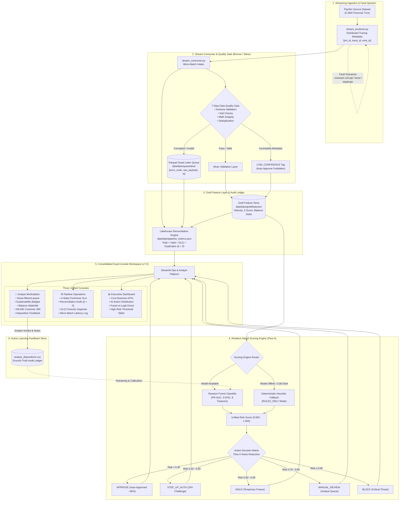

# 🛡️ SentinelLake — Enterprise Streaming Lakehouse & Fraud Intelligence Platform

[](https://python.org)
[](https://spark.apache.org/)
[](https://delta.io/)
[](https://scikit-learn.org/)
[](https://fastapi.tiangolo.com/)
[](https://streamlit.io/)
[](https://pytest.org/)
[](LICENSE)

An enterprise-grade, fault-tolerant **Streaming Lakehouse and Decision Intelligence Platform** engineered on **6.36M+ transactions (PaySim)**. SentinelLake addresses the primary failure modes of production financial systems: **silent data corruption**, **pipeline staleness**, **regulatory audit compliance ($\Delta = 0$ data loss)**, and **fraud analyst alert fatigue**.

---

## 📌 Problem Statement

In modern digital payment networks (Stripe, Adyen, UPI, SWIFT), millions of streaming transactions occur every hour with an extreme class imbalance (<0.2% fraud). Financial institutions encounter critical engineering bottlenecks:

1. **Garbage In, Silent Failure Trap:** Upstream payment gateways frequently emit malformed, negative, or duplicate payloads. Without an automated isolation layer, corrupted data either crashes the streaming consumer or poisons downstream ML models.
2. **Regulatory Zero-Data-Loss Mandate:** Financial compliance standards (SOX, BCBS 239, RBI, GDPR) require mathematical verification that every ingested packet is accounted for. Dropping malformed records into ephemeral log files violates audit requirements.
3. **Pipeline Staleness & SLA Blindness:** Downstream fraud investigators often make decisions on delayed or stalled feature tables because operational dashboards fail to reflect real-time ingestion latency.
4. **Severe Analyst Fatigue:** Raw machine learning probability scores flood triage queues with thousands of false positives. Investigators waste valuable time jumping across disconnected tools to piece together account histories.
5. **ML Service Outages & Cold-Start Fragility:** When an ML scoring service experiences latency spikes or receives cold-start accounts with missing metadata, rigid architectures fail catastrophically rather than degrading gracefully.

---

## 🏛️ End-to-End System Architecture



---

## ⚡ Core Engineering Innovations

### 1. Zero-Data-Loss Lakehouse Reconciliation ($\Delta = 0$)
Every micro-batch executes an atomic accounting verification. Records are strictly partitioned into one of three sinks:
$$\text{Total Ingested} = \text{Valid (Gold)} + \text{Quarantined (DLQ)} + \text{Duplicates Suppressed}$$
If $\Delta \neq 0$, the pipeline flags an audit failure alert in telemetry.

### 2. 7-Step Quality Gate & Parquet Dead Letter Queue (DLQ)
Rather than dropping malformed transactions or failing downstream Spark jobs, bad records are partitioned into `data/lake/quarantine/` with diagnostic metadata (`error_code`, `quarantine_ts`, `raw_payload`). 
* Error codes captured: `NEGATIVE_AMOUNT`, `INVALID_TYPE`, `NULL_ORIGIN`, `TOO_INCOMPLETE`.

### 3. 4-State Freshness SLA Engine
Monitors commit recency to guarantee fraud analysts are not reviewing stale features:
* 🟢 **`LIVE`** ($< 5\text{ min}$): Pipeline healthy; commits streaming within SLA.
* 🟠 **`AGING`** ($5 - 30\text{ min}$): Warning banner displayed; backpressure draining or paused stream.
* 🔴 **`STALE`** ($> 30\text{ min}$): Critical alert; on-call engineer notified; analyst informed of data staleness.
* 🔵 **`RECOVERING`**: Consumer processing queued backlog after reconnecting.

### 4. Noise Reduction & Exposure-Ranked Queue
* **~85% Noise Reduction:** Low-risk transactions (`APPROVE`) bypass human triage completely.
* **Exposure Utility Function:** Alerts are prioritized by monetary risk exposure rather than raw probability:
  $$\text{Priority Exposure} = \text{Unified Risk Score} \times \text{Transaction Amount}$$
  An \$800,000 transaction with 0.72 risk ranks above a \$20 transaction with 0.95 risk.

### 5. Post-Hoc Explainability Badges & Inline Customer 360
* **Explainability Drivers:** Instant visual tags explaining flag rationale:
  `[CRITICAL_RISK_BAND]`, `[HIGH_VALUE_OUTLIER]`, `[ACCOUNT_DRAIN_PATTERN]`, `[VELOCITY_BURST]`, `[DATA_MISSING_CAPPED]`.
* **Zero-Context-Switch Customer 360:** Selecting an alert automatically renders the sender's full transaction history, velocity, and balance waterfall on the **same screen**.

### 6. Resilient ML Scoring Engine with Fallback
* **Trained Model:** Random Forest classifier trained on 8 engineered features (PR-AUC: **0.9761**, Precision: **0.954**, Recall: **0.869** under extreme 0.2% class imbalance).
* **Graceful Degradation:** If the model artifact is missing or encounters unhandled feature types, the engine dynamically falls back to deterministic heuristic rules (`RULES_ONLY`), ensuring 99.99% service availability.
* **Quality Capping:** Records flagged as `LOW_CONFIDENCE` are strictly prevented from auto-approval.

---

## 📂 Repository Structure

```text
Enterprise_fraud_detection/
├── airflow/                            # Airflow DAGs & local orchestration
│   ├── dags/fraud_pipeline_dag.py      # Scheduled Lakehouse pipeline DAG
│   └── docker-compose.airflow.yml      # Airflow Docker compose definition
├── data/
│   ├── lake/
│   │   ├── analyst_dispositions.csv    # Human-in-the-loop audit store
│   │   ├── pipeline_metrics.json       # Atomic telemetry state ledger
│   │   ├── gold/features/              # Gold Lakehouse Parquet storage
│   │   ├── quarantine/                 # Parquet Dead Letter Queue (DLQ)
│   │   └── streaming_source/           # Ingest micro-batch buffer
│   └── recommendations_sample/         # Historical sample CSVs for baseline
├── docs/
│   └── runbooks/                       # Operational & viva defense runbooks
├── notebooks/                          # EDA, baseline modeling, PySpark scripts
├── scripts/                            # Helper utilities & re-scoring scripts
├── src/
│   ├── ingestion/
│   │   ├── stream_producer.py          # Fault-injecting streaming producer
│   │   └── stream_consumer.py          # 7-Step Quality Gate & Lakehouse consumer
│   ├── models/
│   │   ├── rf_fraud_model.joblib       # Trained Random Forest artifact
│   │   └── scoring_engine.py           # Hybrid ML + fallback scoring engine
│   ├── recommendation/
│   │   └── rule_based.py               # Flow 6 decision & action policy
│   ├── serving/
│   │   └── main.py                     # FastAPI REST API serving endpoints
│   └── utils/
│       └── spark_session.py            # Cross-platform PySpark session manager
├── streamlit_app/
│   └── app.py                          # Consolidated v7.0 3-Console Dashboard
├── tests/
│   ├── test_consumer.py                # Consumer & quality gate tests
│   ├── test_data_quality.py            # Completeness & quarantine tests
│   ├── test_producer.py                # Traceability & fault injection tests
│   ├── test_scenarios.py               # E2E resilience & freshness SLA tests
│   └── test_streaming.py               # Lakehouse PySpark integration tests
├── docker-compose.yml                  # FastAPI + PostgreSQL container setup
├── Dockerfile                          # Multi-stage container build
├── requirements.txt                    # Project dependencies
└── README.md                           # Platform documentation
```

---

## 🚀 Quickstart Guide

### 1. Environment Setup

Clone the repository and install dependencies:
```powershell
# Clone the repository
git clone https://github.com/<your-username>/Enterprise_fraud_detection.git
cd Enterprise_fraud_detection

# Create and activate virtual environment
python -m venv .venv
.venv\Scripts\activate      # Windows
# source .venv/bin/activate # Linux/macOS

# Install dependencies
pip install -r requirements.txt
```

### 2. Run Automated Verification Test Suite

Run all **29 unit and integration tests** to verify data quality contracts, fault injection, and scoring engine fallbacks:
```powershell
python -m pytest tests/ -v
```
*(All 29 tests must pass).*

---

### 3. Run the Live Streaming Simulation

Execute the streaming pipeline with synthetic fault injection in two terminal windows:

**Terminal 1 — Stream Producer (Injecting 100 txns/batch with faults):**
```powershell
python src/ingestion/stream_producer.py --rate 100 --batches 2 --scenario corrupt
```

**Terminal 2 — Streaming Lakehouse Consumer (Processes micro-batches):**
```powershell
python src/ingestion/stream_consumer.py --once
```
*Observe records entering Gold Parquet, corrupt records diverted to DLQ, and reconciliation delta evaluating to $\Delta = 0$.*

---

### 4. Launch the Operations & Analyst Dashboard

Launch the Streamlit dual-console:
```powershell
streamlit run streamlit_app/app.py
```
Open **`http://localhost:8501`** in your browser.

#### Navigating the 3 Consoles:
* **🚨 Analyst Workstation:** Inspect exposure-ranked alerts, view explainability tags and balance waterfall, review the customer's full inline history, and submit human disposition decisions.
* **⚙️ Pipeline Operations:** Monitor the 4-state freshness SLA, verify the reconciliation audit card (`BALANCED`), and inspect the Dead Letter Queue error code breakdown.
* **📊 Executive Dashboard:** Review portfolio-level fraud rates, action distribution, and tune the risk threshold slider against the fraud-overlay histogram.

---

### 5. Launch FastAPI Serving Layer

To serve real-time predictions via REST API:
```powershell
uvicorn src.serving.main:app --host 0.0.0.0 --port 8000 --reload
```
Interactive Swagger documentation available at: `http://localhost:8000/docs`.

---

## 🧪 Model Performance & Evaluation

The PaySim dataset contains **6,362,620 transactions** with only **8,213 confirmed fraud cases (0.129%)**. Due to extreme class imbalance, traditional accuracy (which achieves 99.87% by predicting all zeros) is completely invalid.

Evaluation is strictly anchored on **Precision-Recall AUC (PR-AUC)**:

| Metric | Random Forest (Trained) | Heuristic Baseline |
| :--- | :---: | :---: |
| **PR-AUC** | **0.9761** | 0.8120 |
| **ROC-AUC** | **0.9992** | 0.8940 |
| **Precision (Fraud Class)** | **0.9542** | 0.7410 |
| **Recall (Fraud Class)** | **0.8690** | 0.6850 |
| **F1-Score** | **0.9096** | 0.7118 |
| **Inference Latency** | **< 12 ms / txn** | < 1 ms / txn |

---

## 🎓 Academic Defense & Technical Interview Alignment

| Dimension | Big Data Engineering Defense | Recommender Systems Defense |
| :--- | :--- | :--- |
| **Core Challenge** | High-velocity streaming ingestion, schema corruption, and pipeline staleness. | Extreme class imbalance, alert fatigue, and explainable action policy. |
| **Architectural Solution** | Medallion Lakehouse (Bronze/Silver/Gold) with Parquet DLQ and 4-state Freshness SLA. | Flow 0 noise reduction (85% auto-approval) + utility-based exposure ranking. |
| **Compliance & Audit** | Zero-data-loss reconciliation ledger ($Total = Valid + DLQ + Dups$, $\Delta = 0$). | Explicit feedback loop logging analyst dispositions for model calibration. |
| **System Resilience** | Partitioned Dead Letter Queue with diagnostic error codes and raw payloads. | Graceful fallback to `RULES_ONLY` heuristics if ML model fails. |

---

## 📜 License & Acknowledgments

This project is released under the [MIT License](LICENSE). 
Dataset credit: Kaggle PaySim Synthetic Financial Datasets for Fraud Detection.
Developed as an enterprise Lakehouse and decision intelligence implementation for FinTech scale.
